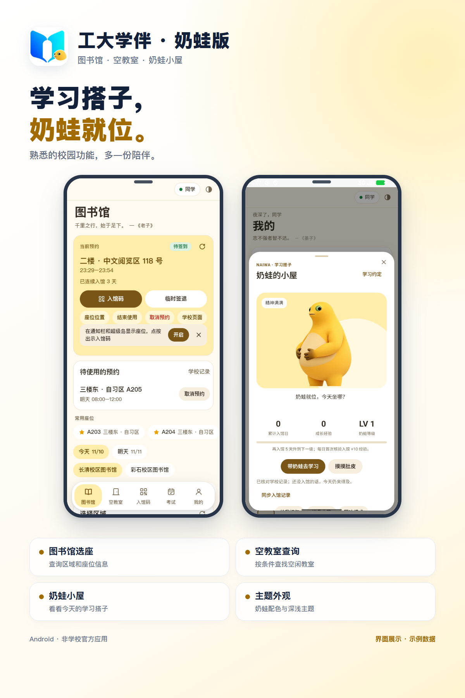

# 🐸 工大学伴 · 奶蛙版

**带奶蛙陪学宠物的工大学伴分支：图书馆选座 · 入馆码 · 签到提醒 · 空教室**

[下载最新版](https://github.com/Leon-Cjl/gongda-xueban-naiwa/releases)

## 更新日志

- 改进登录恢复和会话保持。
- 修复预约日期切换、空教室与考试读取中的问题。
- 优化弹窗和底栏交互，保留奶蛙主题与小屋。

---

## ⚖️ 法律声明与免责条款

> 本声明依据《中华人民共和国网络安全法》《中华人民共和国个人信息保护法》《中华人民共和国刑法》《中华人民共和国民法典》《中华人民共和国著作权法》制定，自项目发布之日起适用。

### 一、非官方性质

本项目为个人开发的非官方应用，与齐鲁工业大学无任何隶属、授权或合作关系。业务功能与普通版一致，另外加了奶蛙主题和「奶蛙小屋」陪学宠物。

依据：
- **《民法典》第1165条**：行为人因过错侵害他人民事权益造成损害的，应当承担侵权责任。
- **《民法典》第1194条**：网络用户、网络服务提供者利用网络侵害他人民事权益的，应当承担侵权责任。

### 二、个人信息保护

应用在本机加密保存用户账号密码，不上传任何服务器，仅与学校官方域名通信。用户可随时撤回同意并清除本机数据。

依据：
- **《个人信息保护法》第13条**：处理个人信息须取得个人同意。
- **《个人信息保护法》第14条**：同意须由个人在充分知情的前提下自愿、明确作出。
- **《个人信息保护法》第15条**：个人有权撤回其同意，处理者应提供便捷的撤回方式。
- **《个人信息保护法》第17条**：处理前应告知处理者名称、联系方式、处理目的、方式、种类、保存期限及权利行使方式。
- **《个人信息保护法》第28条**：账号密码等属于敏感个人信息，须具有特定目的和充分必要性，并采取严格保护措施。
- **《个人信息保护法》第51条**：应采取加密、去标识化等安全技术措施防止未经授权的访问及个人信息泄露。
- **《网络安全法》第41条**：收集使用个人信息须遵循合法、正当、必要原则，公开收集规则，明示目的、方式和范围，并经被收集者同意。
- **《网络安全法》第42条**：不得泄露、篡改、毁损其收集的个人信息。
- **《网络安全法》第44条**：任何个人和组织不得窃取或者以其他非法方式获取个人信息。

### 三、计算机信息系统安全

应用通过 WebView 以用户本人账号正常访问学校官方系统，不侵入、不干扰、不破坏计算机信息系统功能，不提供任何用于侵入或非法控制的程序或工具。

依据：
- **《网络安全法》第27条**：任何个人和组织不得从事非法侵入他人网络、干扰他人网络正常功能、窃取网络数据等危害网络安全的活动；不得提供专门用于从事此类活动的程序、工具。
- **《刑法》第285条第1款**：违反国家规定，侵入国家事务、国防建设、尖端科学技术领域的计算机信息系统的，处三年以下有期徒刑或者拘役。
- **《刑法》第285条第2款**：违反国家规定，获取计算机信息系统中存储、处理或传输的数据，或对其实施非法控制，情节严重的，处三年以下有期徒刑或者拘役，并处或单处罚金。
- **《刑法》第285条第3款**：提供专门用于侵入、非法控制计算机信息系统的程序、工具的，依照前款规定处罚。

### 四、著作权特别声明

奶蛙形象相关的图片（`app/assets/`、`branding/pet-masters/` 及应用图标上的奶蛙角标）是根据网络参考图加工的，**不在 MIT 许可范围内**，著作权归原作者所有。本项目仅出于个人学习交流目的使用，不用于商业用途。

依据：
- **《著作权法》第24条**：为介绍、评论某一作品或者说明某一问题，在作品中适当引用他人已经发表的作品，可以不经著作权人许可，不向其支付报酬，但应当指明作者姓名或者名称、作品名称，并且不得影响该作品的正常使用，也不得不合理地损害著作权人的合法权益。
- **《民法典》第1194条**：网络用户、网络服务提供者利用网络侵害他人民事权益的，应当承担侵权责任。

> 如原作者认为本项目的使用方式侵害了其著作权，请通过 [Issues](https://github.com/Leon-Cjl/gongda-xueban-naiwa/issues) 联系，收到通知后将在合理时间内移除相关素材。

### 五、使用限制与责任

- 仅限本人账号使用，不得代约、转让或倒卖座位。
- 预约、签到以学校系统为准。

依据：
- **《网络安全法》第74条**：违反本法给他人造成损害的依法承担民事责任；构成违反治安管理行为的依法给予治安管理处罚；构成犯罪的依法追究刑事责任。

---

## 🐸 奶蛙小屋

入口：图书馆首页，或「我的 → 奶蛙小屋」。

| 功能 | 说明 |
|---|---|
| 🐣 **领养与取名** | 设置约定学习日 |
| 📈 **成长机制** | 只按学校记录里**明确入馆**的日子成长 |
| 🎭 **五种状态** | 精神满满、打个小盹、有点想你、蔫蔫的、冬眠中 |
| 🎮 **互动** | 摸肚皮、喂点心、打气、送花…… |
| 📖 **图鉴** | 按累计入馆日解锁各种形象、风景和装饰 |
| 🌗 **主题适配** | 跟随明暗主题，支持减少动态效果 |

## 代码结构

和普通版相同（见[普通版 README](https://github.com/Leon-Cjl/gongda-xueban)），多出的文件：

| 文件 | 用途 |
|---|---|
| `app/naiwa-theme.js` 等 | 奶蛙主题 |
| `app/pet-core.js` | 日历、成长和解锁规则 |
| `app/pet-evidence.js` | 从学校记录里认定入馆 |
| `app/pet-ui.js` 等 | 小屋、互动与图鉴 |
| `branding/pet-masters/` | 高清原图 |

## 构建

📦 Gradle 构建步骤

用 Android Studio 打开仓库根目录，或命令行：安装 JDK 17、Android SDK Platform 35 和 Build Tools 35.0.0，在根目录建 `local.properties`，运行 `.\gradlew.bat :android:assembleRelease`。签名文件不要提交（已在 `.gitignore` 里）。

> 用不同签名打的包不能覆盖安装作者发布的安装包。构建建议放在英文路径下。

## 参与开发

由 [Leon-Cjl](https://github.com/Leon-Cjl) 主导，AI 编程助手 Claude、Codex、Gemini 和 DeepSeek 参与了代码编写。

## 许可证

| 内容 | 许可 |
|---|---|
| **代码** | [MIT](LICENSE) 开源 |
| **奶蛙形象图片** | 不在 MIT 范围内，著作权归原作者所有，仅供学习交流，**请勿商用** |
| `app/donate.png` | 作者收款码，请勿在你自己发布的版本里沿用 |

## 相关项目

[Leon 的项目主页](https://github.com/Leon-Cjl) · [校园电费](https://github.com/Leon-Cjl/campus-dianfei) · [工大学伴](https://github.com/Leon-Cjl/gongda-xueban) · [奶蛙版](https://github.com/Leon-Cjl/gongda-xueban-naiwa) · [宿舍快开](https://github.com/Leon-Cjl/dorm-native-open)
